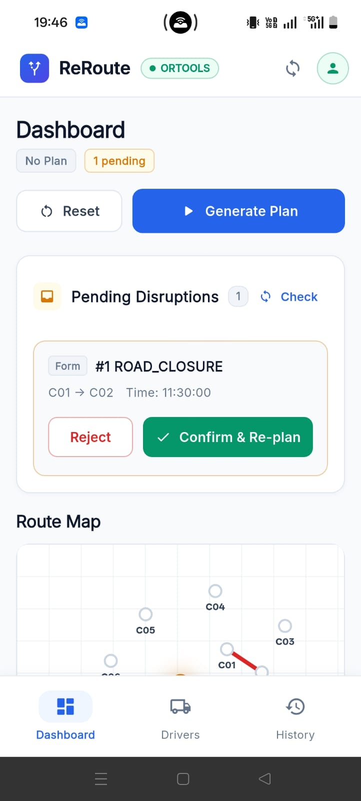
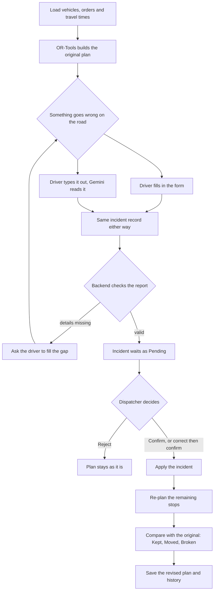
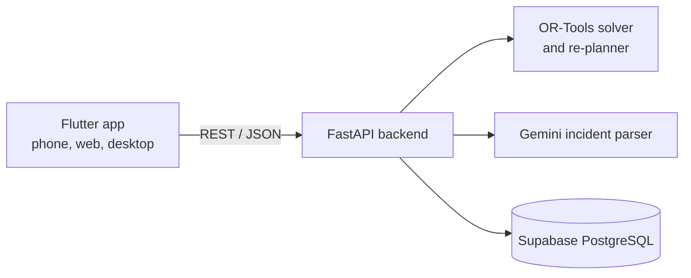

# 🗺️ ReRoute


Re-plans delivery routes when something goes wrong on the road.  
Built for the **VORTEXA 3.0 Hackathon** by **Team FantasyIsland383**.

<br clear="right">

## 🚩 The Problem

A delivery plan is only correct until the first thing goes wrong. A truck breaks down at 11:30, a road gets closed, a customer calls with an urgent order. The dispatcher ends up re-planning by hand over phone calls and a spreadsheet, and it is easy to overload a vehicle, miss a delivery window, or accidentally redo a stop that was already finished.

## ✨ What ReRoute Does

Drivers report what happened from their phone. The dispatcher checks the report and confirms it. Then the planner rebuilds the remaining routes and shows exactly what changed and why.

- **🚑 Three kinds of incident:** Vehicle breakdown, road closure, and urgent order.
- **🤖 AI-Powered Reporting:** A short form, or plain text such as *"V02 broke down near C04 at 11:30, can't continue"*. Gemini reads the text and fills in the form; the driver can see and fix what it understood.
- **👨‍✈️ Dispatcher in control:** Nothing changes in the plan until the dispatcher confirms the incident.
- **⚙️ Reliable Planning:** The AI never plans routes. It only reads text. Routing, capacity checks, and time windows are handled by Google OR-Tools.
- **📋 Clear Results:** Every order gets a verdict: **Kept** (unchanged), **Moved** (different vehicle or time), or **Broken** (can't be delivered), with a reason.

## 📱 Screenshots

The ReRoute mobile interface includes separate experiences for drivers and dispatchers.

### Driver Panel
| Driver Dashboard | Report Incident — Form | Report Incident — AI Parser |
| :---: | :---: | :---: |
|  |  |  |

### Admin / Dispatcher Panel
| Dispatcher Dashboard | Route Map | Fleet Overview | Delivery Manifest |
| :---: | :---: | :---: | :---: |
|  |  |  |  |

## 🛠️ How it works



The checks in the second diamond: the vehicle exists, the location exists, the time is valid, and it isn't a duplicate of an incident already reported.

### Rules the planner follows

- Stops that are already finished never change.
- A failed vehicle gets no new stops after its failure time.
- No vehicle goes over its weight or volume limit.
- Re-planning never schedules anything before the time of the incident.
- A road closure adds travel time to that road in both directions (until the end time, or 60 minutes if none is given). Shortest paths are then recomputed, and confirmed closures stay applied on later re-plans until they expire.
- An order that can't be placed is marked Broken with the reason (capacity, time window, or no vehicle available).

### Architecture



## 🌟 MVP

What works today:

- **📅 Initial Planning:** 3 vehicles and 10 orders with capacity and time-window constraints.
- **⏱️ Precise Timing:** Arrival, waiting, and departure times for every stop.
- **📲 Driver App:** Incident reporting via form and AI-powered text parser.
- **🖥️ Dispatcher Dashboard:** Manage pending incidents, confirm/reject, and re-plan.
- **🔄 Smart Re-planning:** Handles breakdowns, closures, and urgent orders.
- **📈 Plan Comparison:** Original vs. revised plans with status (Kept/Moved/Broken).
- **🗺️ Visuals:** Route map and re-planning history.
- **💾 Flexible Data:** Works with or without a database (in-memory demo mode).
- **🧪 Robust Backend:** Comprehensive tests for solver, re-planner, and services.

> **Note:** Left out on purpose: live GPS, live traffic, automatic location detection, real road maps. Travel times come from a simulated matrix, and sign-in on this branch is a simple role picker.

## 💻 Tech Stack

| Part | Technology |
| :--- | :--- |
| **App** | Flutter (Dart), `http`, `google_fonts` |
| **Backend** | Python, FastAPI, Uvicorn |
| **Route Optimization** | Google OR-Tools |
| **Incident Parser** | Gemini API (`google-genai`) |
| **Database** | Supabase PostgreSQL |
| **Testing** | pytest |
| **Config** | python-dotenv |

## 📋 Requirements

**Backend (any machine)**
- Python 3.10 or newer
- A Supabase project, or nothing at all: `REROUTE_REPO=memory` runs on built-in demo data.
- A Gemini API key, only if you want the AI text parser.

**App (all platforms)**
- Flutter stable with Dart 3.13.5 or newer (see `reroute_app/pubspec.yaml`).
- The backend running and reachable from the device.

**On a phone**
- Android: Android Studio with the Android SDK, plus an emulator or a real phone with USB debugging on.
- iPhone: a Mac with Xcode (simulator or a real device).
- A real phone and the laptop must be on the same Wi-Fi network.

**On desktop or web**
- Web: Chrome.
- Windows: Visual Studio with the "Desktop development with C++" workload.
- macOS: Xcode. Linux: the usual Flutter Linux build tools (`flutter doctor` tells you what is missing).

## 🚀 Getting Started

### 1. Backend

From the repo root:

```bash
python -m venv .venv
source .venv/bin/activate          # Windows: .venv\Scripts\activate
pip install -r requirements.txt
pip install google-genai           # only needed for the AI parser

cd reroute-backend
cp .env.example .env               # then fill it in
uvicorn app.main:app --reload --host 0.0.0.0 --port 8000
```

No Supabase yet? Start it in demo mode instead:

```bash
REROUTE_REPO=memory uvicorn app.main:app --reload --host 0.0.0.0 --port 8000
# PowerShell: $env:REROUTE_REPO="memory"; uvicorn app.main:app --reload --host 0.0.0.0 --port 8000
```

API docs open at http://localhost:8000/docs.

**Using Supabase:** in the SQL editor run `db/schema.sql`, then `db/migration_001.sql`, then `db/seed.sql`. Put `SUPABASE_URL` and the **service_role** key in `.env`. That key stays on the backend, never in the app. `GEMINI_API_KEY` goes there too if you want the parser.

### 2. App

```bash
cd reroute_app
flutter pub get
flutter run -d chrome              # web
flutter run -d windows             # desktop (or macos / linux)
flutter run                        # connected phone or emulator
```

The app talks to `http://127.0.0.1:8000` by default. If the app is on another device, sign in, and when the home screen shows Offline use **Backend Connection** (also in the side menu) to change the address:

| App runs on | Backend URL |
|---|---|
| Chrome, Windows, macOS, Linux, iOS simulator | `http://127.0.0.1:8000` |
| Android emulator | `http://10.0.2.2:8000` |
| Real phone | `http://<your laptop's IP>:8000` |

If a real phone can't connect, check that the laptop's firewall allows port 8000. For a release build on Android, the `INTERNET` permission also has to be added to `android/app/src/main/AndroidManifest.xml` (it is only in the debug and profile manifests right now), and plain `http://` may need to be allowed for the demo.

### 3. Try the demo

1. Sign in as **Dispatcher** and press the button that generates the initial plan.
2. Sign out, sign in as **Driver** (pick a vehicle) and report a breakdown with the form.
3. Report a second one by typing it out in the AI parser tab.
4. Back as Dispatcher, open the pending incidents and confirm one.
5. Open the revised plan: check what was Kept, Moved or Broken, and that finished stops didn't move.

## 📡 Endpoints

| Endpoint | Description |
| :--- | :--- |
| `GET /health`, `GET /state` | Status and current data |
| `POST /plans/initial` | Build the original plan |
| `GET /plans`, `/plans/latest`, `/plans/{id}`, `/plans/{id}/compare` | Plans and comparisons |
| `POST /incidents` | Report an incident (`source`: `FORM` or `AI_PARSER`) |
| `POST /incidents/parse` | Free text to structured preview (not saved) |
| `GET /incidents?status=PENDING`, `PATCH /incidents/{id}` | List and correct |
| `POST /incidents/{id}/confirm`, `/reject` | Dispatcher decision |
| `GET /history`, `POST /admin/reset` | History, and a reset for demo re-runs |

Times are `"HH:MM"` in JSON. A stop with `vehicle_id = null` is an unassigned order (Broken, with a reason).

## 🧪 Tests

```bash
cd reroute-backend
pytest -q
```

## 📁 Project Layout

```
reroute-backend/   FastAPI app, solver, re-planner, SQL (db/), tests
reroute_app/       Flutter app (driver, dispatcher and history screens)
requirements.txt   Python dependencies
```

## 👥 Team

**Team FantasyIsland383**

- Fahim
- Kartik
- Ishan
- [Siddhant](https://github.com/SiddhantNK)

## License

MIT. See [LICENSE](LICENSE).
